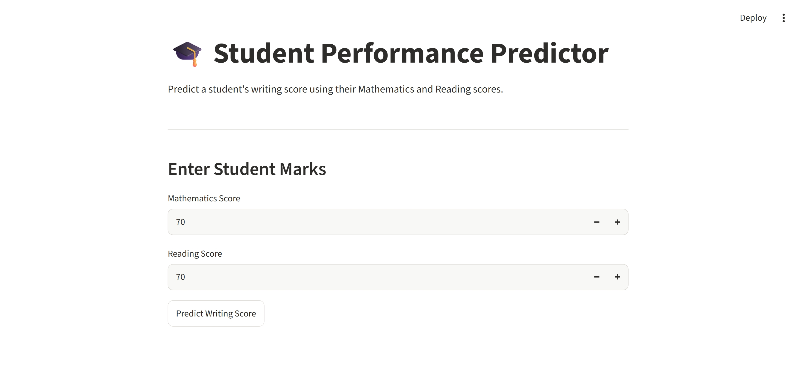
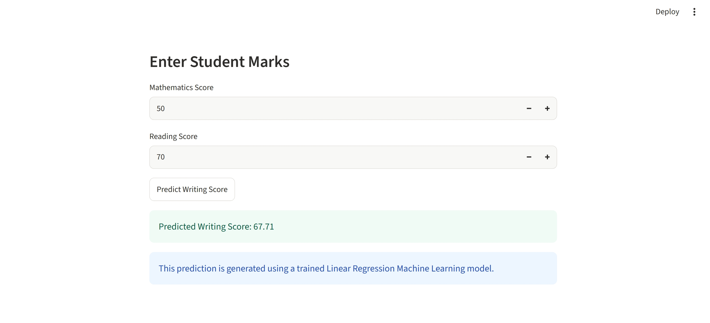

<div align="center">

# 🎓 Student Performance Predictor

**An AI/ML web app that predicts a student's Writing score from their Math and Reading scores.**


</div>

---

## 📌 Overview

**Student Performance Predictor** is a Machine Learning application that estimates a student's **Writing score** based on their **Mathematics** and **Reading** scores.

It uses a **Linear Regression** model trained on 1,000 student records and comes with an interactive web interface built with **Streamlit**, so anyone can try it without writing any code.

---

## 🎯 Problem Statement

Teachers and schools often want to know early which students might struggle in a subject, so they can offer help before it affects final results.

This project shows how AI/ML can be applied to that real-world problem: given a student's **Math** and **Reading** scores, the app predicts their likely **Writing** score. A low predicted score can be a signal that a student may need extra writing support.

---

## ⚙️ How It Works

1. **Data**: the model learns from a dataset of 1,000 student records.
2. **Training**: `train_model.py` splits the data (80% training, 20% testing), trains a Linear Regression model and measures how accurate it is.
3. **Saving**: the trained model is saved to `model.pkl` using Joblib.
4. **Prediction**: `app.py` loads the saved model. The user enters Math and Reading scores, and the model returns a predicted Writing score instantly.

```
Math score + Reading score  ──►  Linear Regression model  ──►  Predicted Writing score
```

---

## ✨ Features

- 🧮 Enter a student's **Mathematics** score
- 📖 Enter a student's **Reading** score
- ✍️ Get an instant **Writing score** prediction
- 🌐 Simple, interactive web interface
- 💾 Pre-trained model saved and reused, so no retraining is needed to use the app

---

## 🎥 Demo Video

> 📺 **Watch the demo:** [Click here to watch demo.mp4](demo/demo.mp4)

---

## 📸 Screenshots

> Add your screenshots to a `screenshots/` folder and update the paths below.

| Home Page | Prediction Result |
|-----------|-------------------|
|  |  |

---

## 📂 Dataset

The project uses `student_performance.csv`, which contains **1,000 student records** with these columns:

| Column | Description |
|--------|-------------|
| `gender` | Student's gender |
| `race/ethnicity` | Student's group |
| `parental level of education` | Highest education level of the parents |
| `lunch` | Standard or free/reduced lunch |
| `test preparation course` | Whether the student completed a test prep course |
| `math score` | Mathematics score ✅ *used as input* |
| `reading score` | Reading score ✅ *used as input* |
| `writing score` | Writing score 🎯 *the value we predict* |

> The model uses only the **Math** and **Reading** scores as inputs. The other columns are part of the dataset but are not used for prediction.

---

## 🧠 Machine Learning Model

| Detail | Value |
|--------|-------|
| **Algorithm** | Linear Regression |
| **Input features** | Math score, Reading score |
| **Target** | Writing score |
| **Training data** | 80% |
| **Testing data** | 20% |

### 📊 Model Performance

| Metric | Score |
|--------|-------|
| **Mean Absolute Error (MAE)** | 3.84 |
| **R² Score** | 0.902 |

> An R² of **0.902** means the model explains about **90%** of the variation in Writing scores, and its predictions are off by roughly **4 points** on average.

---

## 🛠️ Technologies Used

| Tool | Purpose |
|------|---------|
| 🐍 **Python 3.12** | Main programming language |
| 🐼 **Pandas** | Loading and handling data |
| 🔢 **NumPy** | Numerical operations |
| 🤖 **Scikit-learn** | Training and evaluating the model |
| 🎈 **Streamlit** | Building the web interface |
| 💾 **Joblib** | Saving and loading the trained model |

---

## 🚀 Setup and Installation

**1️⃣ Clone or download this repository**

```bash
git clone https://github.com/Falakmuzaffar-AI12/Student-Performance-Predictor.git
cd Student-Performance-Predictor
```

**2️⃣ (Recommended) Create and activate a virtual environment**

```bash
python -m venv venv
venv\Scripts\activate
```

> On Mac/Linux, use `source venv/bin/activate` instead.

**3️⃣ Install the required dependencies**

```bash
pip install -r requirements.txt
```

**4️⃣ Train the model**

```bash
python train_model.py
```

**5️⃣ Launch the application**

```bash
streamlit run app.py
```

The app opens in your browser automatically. 🎉

---

## 📖 How to Use

1. Start the app with `streamlit run app.py`.
2. Enter the **Mathematics Score** (0 to 100).
3. Enter the **Reading Score** (0 to 100).
4. Click the **Predict Writing Score** button.
5. The **Predicted Writing Score** appears in a green box. Predictions are kept between 0 and 100.

---

## 🗂️ Project Structure

```
Student-Performance-Predictor/
│
├── dataset/                  # Student dataset
│   └── student_performance.csv
├── demo/                     # Demo video
│   └── demo.mp4
├── screenshots/              # App screenshots
├── train_model.py            # Model training and evaluation
├── app.py                    # Streamlit application
├── model.pkl                 # Saved trained model
├── requirements.txt          # Project dependencies
└── README.md                 # Project documentation
```

---

## ⚠️ Limitations

- Predictions are **estimates**, not guarantees. They should support teachers, not replace their judgement.
- The model uses only two inputs (Math and Reading scores) and a simple Linear Regression algorithm.
- It was trained on a limited dataset of 1,000 records.

---

## 👩‍💻 Developed By

**Falak Muzaffar**

*An AI and Machine Learning project.*

---

<div align="center">

⭐ If you found this project useful, consider giving it a star!

</div>
